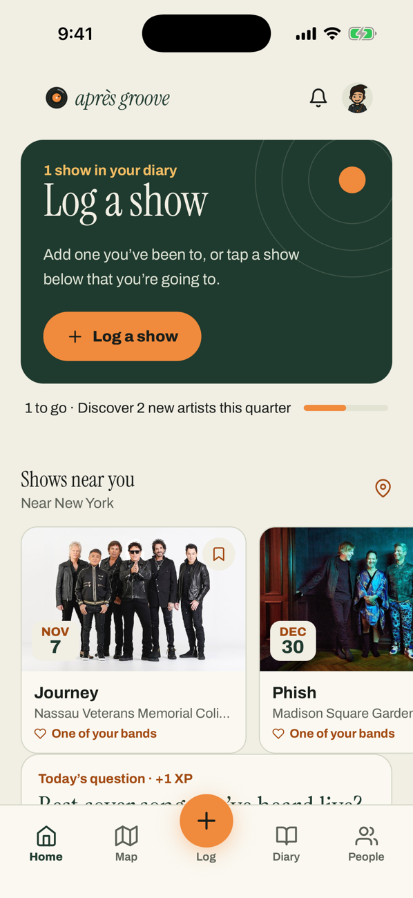
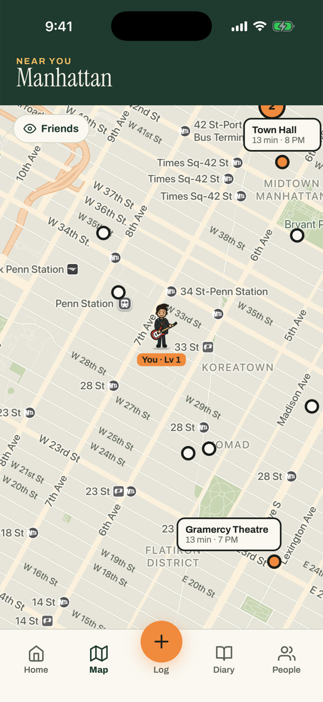
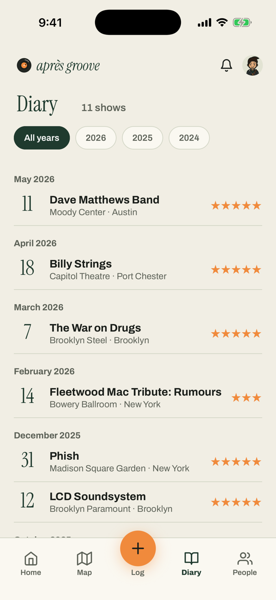
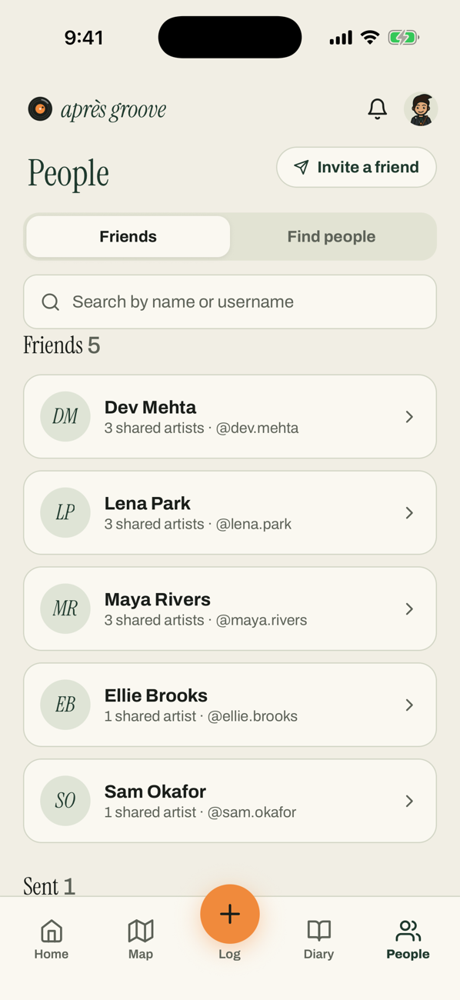
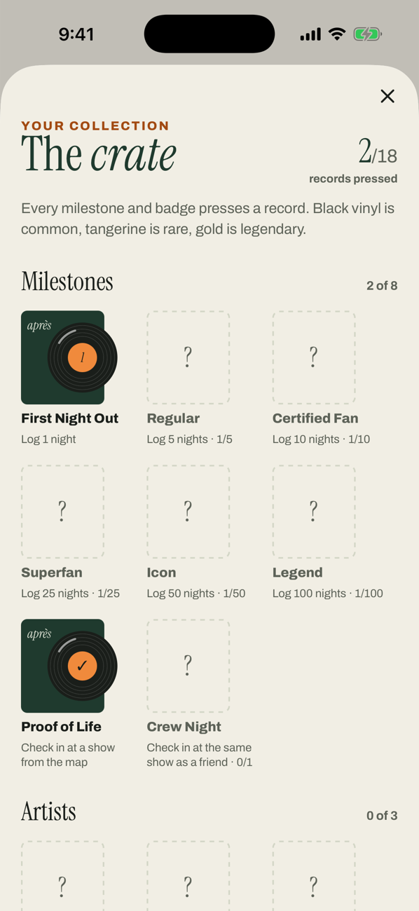

## Hi, I'm Jake 👋

I spent five years working with startups on capital raises at StartEngine. Along the way, I began building tools to solve problems I encountered in financial analysis, reporting, and client workflows. I recently graduated with an MBA from UT Austin’s McCombs School of Business.

I build automations with n8n, GPT, SQL, and Claude, and I’m learning full-stack development by making products I want to use.

### 🎵 Après (formerly Groovy): a social concert diary

[Après](https://groovy-web-smo9.onrender.com) is Strava for concerts: a place to keep a record of the shows you’ve attended, discover what’s coming next, and connect with people through shared live music history. I built it with the help of AI coding tools.

* Save shows with ratings and notes
* Import concert history from Setlist.fm
* Discover upcoming shows through Ticketmaster
* Find friends with similar music taste
* Check in at shows on a live map as your own character
* Collect milestone records in the Crate

| Home | Map | Diary |
| :---: | :---: | :---: |
|  |  |  |

| People | The Crate |
| :---: | :---: |
|  |  |

**Built with:** React Native, Expo, TypeScript, Express, PostgreSQL, React Query, Clerk, and OpenAPI-generated clients.

### Background

As Director of Funding Growth at StartEngine, I worked with more than 100 companies on capital raises that collectively brought in over $140 million. I also built financial models and more than 10 automations for reporting, investor analysis, and client workflows.

📫 [LinkedIn](https://www.linkedin.com/in/jacob-landy/) · [jacoblandy@gmail.com](mailto:jacoblandy@gmail.com)
