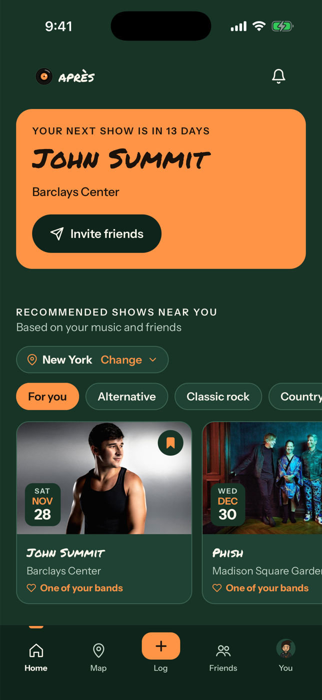
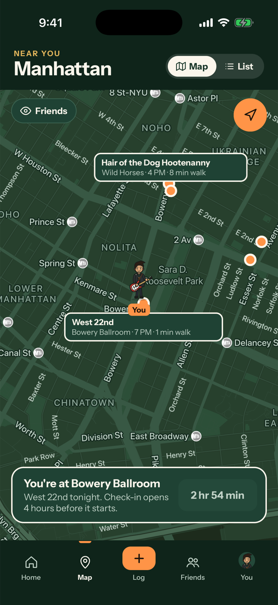
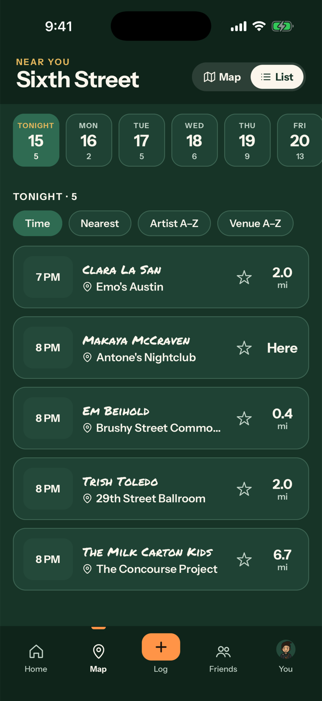
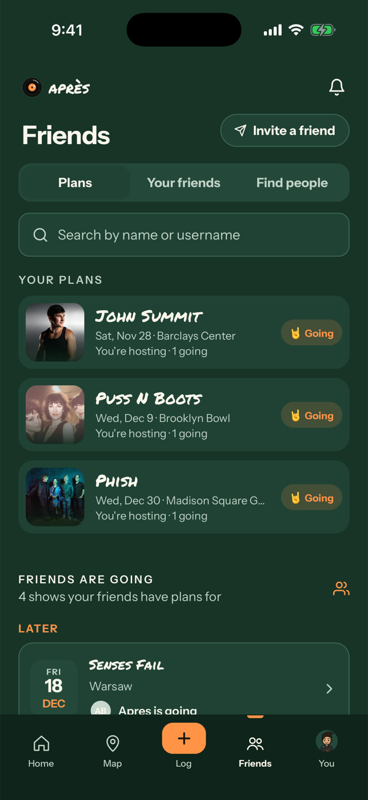
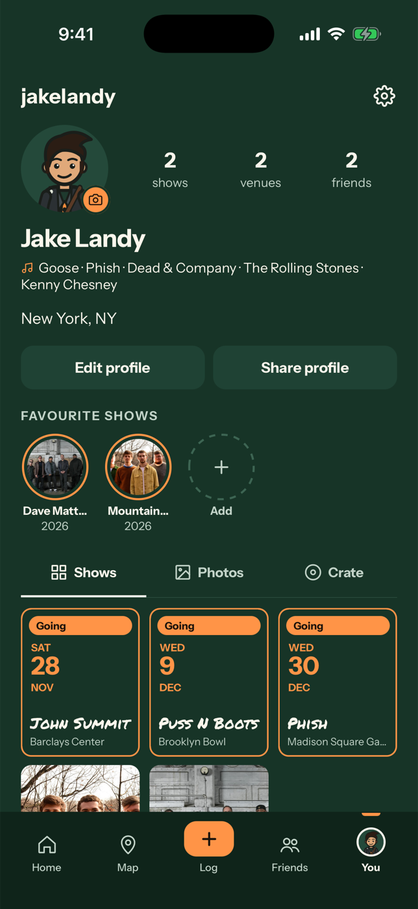
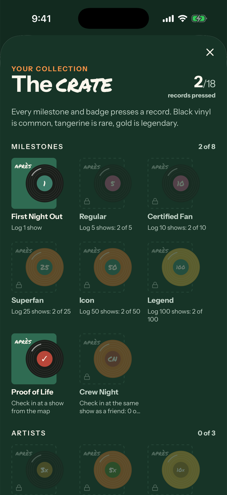

## Hi, I'm Jake 👋

I spent five years working with startups on capital raises at StartEngine. Along the way, I began building tools to solve problems I encountered in financial analysis, reporting, and client workflows. I recently graduated with an MBA from UT Austin’s McCombs School of Business.

I build automations with n8n, GPT, SQL, and Claude, and I’m learning full-stack development by making products I want to use.

### 🎵 Après: live music with your friends

[Après](https://apresgroove.app) is Strava for concerts: see which shows your friends are going to, make plans together, find what's on near you tonight, and keep every show you've been to. I'm building it with AI coding tools, and friends are testing it now.

* See every show your friends have plans for, and make plans with invites, RSVPs and a group chat
* Find tonight's shows near you on a map or a night-by-night list (Ticketmaster and SeatGeek), and star your favourite venues
* Check in at the venue, or automatically when you arrive at a show you said you're going to
* Keep a diary of every show with ratings, notes, photos and setlists, and import past shows from Setlist.fm and Ticketmaster
* Get ticket reminders before on-sales and a "Did you go?" the morning after
* Collect milestone records in the Crate

| Home | Map | Tonight's list |
| :---: | :---: | :---: |
|  |  |  |

| Friends | Profile | The Crate |
| :---: | :---: | :---: |
|  |  |  |

**Built with:** React Native, Expo (EAS builds and over-the-air updates), TypeScript, Express, PostgreSQL (Neon), Drizzle, React Query, Clerk, OpenAPI-generated clients, Render, and Cloudflare Workers.

### Background

As Director of Funding Growth at StartEngine, I worked with more than 100 companies on capital raises that collectively brought in over $140 million. I also built financial models and more than 10 automations for reporting, investor analysis, and client workflows.

📫 [LinkedIn](https://www.linkedin.com/in/jacob-landy/) · [jacoblandy@gmail.com](mailto:jacoblandy@gmail.com)
